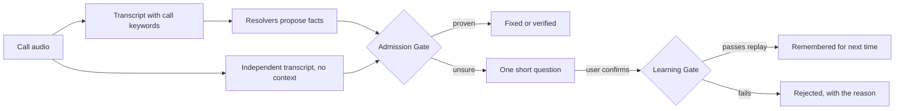

# Pehchaan

### Every fact in an Indian call: right ✓, or it asks ?

That is the goal, and we are not there yet. On our locked exam, 16% of facts still slip through silently, down from 26% with
keywords alone.

**Try it:** https://52-24-174-127.sslip.io · **API docs:** https://52-24-174-127.sslip.io/docs

**Pehchaan** (पहचान, "recognition") is a safety layer for voice AI in India. It sits between a speech model and whatever
acts on the transcript, and it checks the facts that matter.

## The idea in one minute

Imagine a friend taking notes on your phone call. They write down almost everything correctly. But they write **Mohit**
when the caller said **Rohit**, or **₹40,500** when the caller said **₹14,500**, and they don't tell you they were unsure.
You call the wrong person. You pay the wrong amount.

Speech AI makes this same mistake. We call it a **silent error**: a fact that is wrong, with no warning.

Pehchaan checks every name, place, brand, phone number, PIN and rupee amount, and does one of three things:

| What Pehchaan does | When | Example |
|---|---|---|
| **Keeps it** | The evidence agrees | "98005 12346" stays as heard |
| **Fixes it** | A name or place was clearly misheard, and the phone knows the right one | "Bomma halli" becomes Bommanahalli |
| **Asks one short question** | It cannot be sure | *"Rohit or Mohit?"* |

Two promises never bend: **phone numbers, PINs and money are never changed automatically**, and a hint from the phone
cannot replace a different name that two separate transcripts both heard.

Pehchaan is **a layer, not an app**. Any product that acts on facts heard in speech (call summaries, voice agents, support
bots, delivery and banking calls) can put it behind its speech model. It accepts text from any model. We measured four
OpenAI speech models. Other providers work through the same call, but we have not benchmarked them.

Built for BUILDERS '26 (OpenAI x Equal AI), Track 2: **Build Challenging, Voice AI for India**.

## Add it in one line

```bash
pip install "git+https://github.com/dev-seek/Pehchaan.git"
```

```python
from openai import OpenAI
from pehchaan_sdk import wrap

client = wrap(OpenAI(), city="Hyderabad", contacts=["Ravi Kumar"])  # the only new line

result = client.audio.transcriptions.create(model="gpt-transcribe", file=open("call.wav", "rb"))
print(result.text)                       # the checked transcript
print(result.pehchaan.clarifier_prompt)  # one question to ask, or None
```

Your code keeps working the same way. `wrap` also takes `AsyncOpenAI`, `AzureOpenAI`, or **any function that returns a
transcript**, so Deepgram, Sarvam, Google, Azure Speech, AssemblyAI or your own model work too:

```python
transcribe = wrap(my_speech_function, city="Hyderabad", contacts=["Ravi Kumar"])
result = transcribe("call.wav")
```

Try one call with no code (needs `OPENAI_API_KEY`):

```bash
uvx --from "git+https://github.com/dev-seek/Pehchaan.git" pehchaan call.wav --city Hyderabad --contact "Ravi Kumar"
```

Not using Python? Point any OpenAI client at `https://52-24-174-127.sslip.io/v1`. The site's **Integrate** tab has a working
snippet for each provider. We measured four OpenAI speech models. Other providers run through the same check, but they have
not been benchmarked or run against their live APIs, so their results are marked `unmeasured`.

Every fact comes back as **FIXED** (changed, with a reason), **VERIFIED** (evidence matches), **HEARD** (no evidence either
way) or **FLAGGED** (ask the caller).

### Connect what your company already knows

```python
from pehchaan_sdk import wrap, HttpSource

crm = HttpSource("crm", "https://crm.example.in/customers?phone={phone}",
                 fields={"people": "records.*.Name", "amounts.emi": "records.0.Emi"})
client = wrap(OpenAI(), knowledge=[crm], caller={"number": "9848012345"})   # the caller is how records are found
```

CRMs, billing and order systems are asked about each caller at the same time, inside 250 ms. A slow one is skipped. Their
records can confirm a fact or raise a question, and they never change money, PINs or phone numbers. The **Company data** tab
shows this with simulated systems and invented customers. No real company is connected, and it is not a benchmark result.

## Which languages work

**Not every language.** Here is the honest picture:

| Level | Languages | What works |
|---|---|---|
| **Tested on real voice** | Hindi, Hinglish, Indian English | Everything, as measured on the locked exam |
| **Built, synthetic voice only** | Telugu | Full language pack, no real-voice test yet |
| **Partial** | Marathi, Tamil, Kannada, Malayalam, Bengali, Gujarati, Punjabi, Odia, Assamese | Names and digit numbers usually work. Places work or become a question. Spoken money is kept as said and flagged, never guessed |
| **Not supported** | Urdu script, Arabic, Spanish and other non-Indian languages | Digit numbers may pass through. Nothing else is reliable |

Partial languages have **no accuracy number**. Adding one properly takes a language pack, native-speaker test sentences, real
recordings and a new locked exam. [`docs/LANGUAGES.md`](docs/LANGUAGES.md) explains how we checked and exactly what each
language needs.

## The same recording, three systems

A real output from our sample calls. The phone's hints have been deliberately poisoned with a similar-looking contact and
number, which is the situation where a helpful AI does the most harm.

| System | What it wrote | Result |
|---|---|---|
| **What was said** | Priya Malhotra ... callback **98005 12346** | |
| Simple LLM fixer | **Pooja** Malhotra ... callback 98005 **12348** | Wrong person, wrong number, no warning |
| **Pehchaan** | Priya Malhotra ... callback 98005 12346 | Both facts intact |

## Measured results

The main test is a **30-clip single-speaker real-voice test (simulated phone line)** with 82 labelled facts. It ran once on
each of two phone lines, on code frozen before the run. An independent scorer that shares no code with the engine marked
every fact.

| System (normal call hints) | Standard: right | Standard: silent errors | Noisy: right | Noisy: silent errors |
|---|---|---|---|---|
| Plain speech-to-text | 56.1% | 43.9% | 35.4% | 64.6% |
| OpenAI keywords | 74.4% | 25.6% | 54.9% | 45.1% |
| Simple LLM fixer | 59.8% | 40.2% | 24.4% | 75.6% |
| **Pehchaan on top of keywords** | **75.6%** | **15.9%** | **54.9%** | **31.7%** |

A **silent error** is a fact that is wrong with no warning. Read the ladder step by step: the big first drop comes from
OpenAI's keyword feature. Only the last step is Pehchaan.

Against keywords alone, with normal hints:

- Silent errors fell from **21 to 13** on the standard line and **37 to 26** on the noisy line (30-38% fewer).
- Silent money, phone and PIN errors fell from **8 to 3** and **17 to 8**, out of 32.
- No clip ended up with more silent errors.

What this does **not** show:

- **Pehchaan mostly asks rather than fixes.** Right facts barely moved (61 to 62, and 45 to 45, of 82).
- **It can still do harm.** A damaging edit changes right text into wrong text. Pehchaan made 0 and 1 with normal hints, and
  1 and 2 with deliberately misleading hints. With misleading hints the drop in silent errors is 24-27%.
- **This is one speaker on a simulated phone line.** The 95% intervals of Pehchaan and keywords overlap. The clip-by-clip
  comparison excludes zero, but we chose it after seeing the results.

On our 60 synthetic development calls Pehchaan reached 97.6% right and 1.2% silent. We tuned on those calls, so that number is
optimistic and it did not carry over to real voice.

### Real voice on worse and worse phone lines

We recorded six fresh calls in a real human voice, then played them through a harder and harder phone line. Each cell
counts the **facts wrong with no warning, out of 21**. Lower is better.

| Line | Plain speech-to-text | LLM fixer | **Pehchaan** | LLM fixer, misleading hints | **Pehchaan**, misleading hints |
|---|---|---|---|---|---|
| Clear recording | 0 | 0 | **0** (asked 0) | 11 | **0** (asked 3) |
| Phone line | 0 | 0 | **0** (asked 0) | 9 | **0** (asked 3) |
| Noisy line | 3 | 2 | **1** (asked 1) | 12 | **2** (asked 2) |
| Very noisy line | 9 | 9 | **2** (asked 5) | 16 | **5** (asked 4) |
| Line with dropouts | 11 | 5 | **5** (asked 4) | 14 | **7** (asked 4) |

What this says, including the parts that don't flatter us:

- **On a clear line the base model is already right**, so there is nothing to fix. Pehchaan's job there is to change nothing.
- **When the line gets bad, silent mistakes become questions** that a person can answer.
- **Pehchaan is not always ahead.** With dropouts, the LLM fixer got more facts right under normal hints (16 against 14).
- This is **6 calls, 21 facts and one speaker**, and we used these clips to find and fix bugs. Treat it as a direction, not a rate.

## How it works



1. **Context.** Uses what the phone already knows: contacts, caller ID, SMS, saved places and city.
2. **Number grammar.** Reads lakh, crore, dedh, dhai and "double nine" across scripts, then validates 10-digit mobiles and 6-digit PINs.
3. **Cross-script sound matching.** कोंडापुर, కొండాపూర్ and Kondapoor are the same sound. An LLM judge is called only for ambiguous cases.
4. **Admission Gate.** A model's suggestion is a proposal, not an edit. The gate enforces the rules no component can bypass:
   - Phone numbers, PINs and money are **never changed automatically**. A suspected error becomes a question.
   - "delivery" never becomes the brand "Delhivery".
   - A place is never replaced by a contact's name.
   - If a transcript made without context did not hear a name, or clearly heard a different one, Pehchaan asks.
   - A learned correction can never overwrite a real, known name that the caller actually said.
5. **Verified learning.** When a user answers a question, that answer is only a *candidate*. It becomes automatic only if it
   sounds like what was heard, is not an everyday word, repairs this call, and harms **no fact across 60 labelled calls**.
   Every decision is logged and can be undone.

### Does learning really help?

We taught Pehchaan from one voice, then scored a **different voice it had never heard**, in both directions.

| Context available | Correct facts (of 164) | Silent errors | Facts harmed | Wrong answers blocked |
|---|---|---|---|---|
| None | 138 → **150** | 23 → **11** | 0 | 17 of 17 |
| Known brands and places | 144 → **152** | 17 → **9** | 0 | 13 of 13 |
| Full call context | 154 → **156** | 7 → **5** | 0 | 6 of 6 |

These use scripted confirmations on dev data, with the LLM judge off, and the same names recurring in another voice. Numbers
are never learned.

## Why this is a harness

| A harness must | In Pehchaan |
|---|---|
| Separate proposing from acting | Resolvers propose, the Admission Gate decides |
| Accept work independently | A clean-room scorer with its own number and name tables |
| Audit what it changes | Every edit is classed as format, repair or damage |
| Refuse to get worse | A regression gate blocks any change that worsens a measured promise |
| Learn with evidence | Candidates are replayed, adopted or rejected, logged, and reversible |
| Keep a human in charge | One short question, and adoption of a new baseline is deliberate |
| Protect the exam | A hash-locked test set that can run only once |

## Run it

```bash
make setup             # Python environment and dependencies (ffmpeg is needed for audio tools)
cp .env.example .env   # add OPENAI_API_KEY
make check             # lint, tests and repo invariants
make serve             # http://localhost:8000
```

The **Live Playground** has five working demos: **Compare**, **Your voice** (connect, choose a model, speak), **Context**,
**vs LLM** and **Learning**. The **Benchmark Lab** has the exam, line-quality curve, model and language tables. **Integrate**
has the one-line setup. Every status has an info button that explains what it means in the real world.

The sample calls work without an API key because their model answers ship in the repo. Live calls need the demo passcode or
your own OpenAI key.

| Command | What it does |
|---|---|
| `make bench-dev` | Runs the real benchmark on the dev clips (answers are cached) |
| `make gate` | Fails if the latest run is worse than the adopted baseline |
| `make learning-proof` | Measures learning on a held-out voice |
| `make real-check` | Runs the real-voice samples on five line qualities |
| `make publish` | Packages results and sample answers, then proves every sample runs offline |
| `make serve-public` | Runs the locked public mode |

### Deploying publicly

The app is **locked unless told otherwise**. Without `PEHCHAAN_MODE=local`:

- Recording, test-script, studio and memory endpoints do not exist.
- Sample calls replay from packaged answers and cannot spend API credits.
- Live calls need a passcode or the caller's own OpenAI key. They are limited to 15 per hour per address, 150 per day and 30 seconds or 5 MB per clip (`config/settings.yaml`).
- `make deploy` ships the committed code to AWS. Secrets stay on the server, never in git.

## Repo map

| Path | What is there |
|---|---|
| `pehchaan/` | The engine: text, languages, sound, numbers, context, ASR, judge, resolvers, policy, output |
| `bench/` | Benchmark, independent oracle, regression gate, verified learning, exam guard |
| `pehchaan_sdk/` | The installable SDK: one-line `wrap()`, the `pehchaan` command, speech adapters and the `Pehchaan` client |
| `app/` | Server, public API, live stream, access control, website |
| `deploy/` | Repeatable AWS deployment and the outside-in verification script |
| `data/languages/`, `data/lexicons/` | Language packs and brand and place lists ([what a new language needs](docs/LANGUAGES.md)) |
| `config/settings.yaml` | Every threshold, model name and limit |
| `docs/` | Architecture, evaluation method, decisions, API, plan and log |

Start with [`docs/00_START_HERE.md`](docs/00_START_HERE.md). The method is in [`docs/EVAL.md`](docs/EVAL.md), and every
design choice is in [`docs/DECISIONS.md`](docs/DECISIONS.md).
