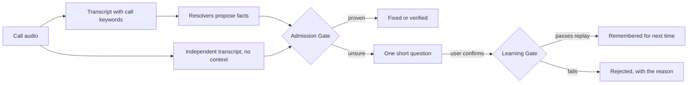

# Pehchaan

### Every fact in an Indian call: right, or it asks.

**Pehchaan** (पहचान, "recognition") is a safety layer for voice AI in India. It sits between a speech model and whatever
acts on the transcript, and it checks the facts that matter.

## The idea in one minute

Imagine a friend taking notes on your phone call. They write down almost everything correctly. But they write **Mohit**
when the caller said **Rohit**, or **₹40,500** when the caller said **₹14,500**, and they don't tell you they were unsure.
You call the wrong person. You pay the wrong amount.

Speech AI makes this same mistake. We call it a **silent error**: a fact that is wrong, with no warning.

Pehchaan checks every name, place, brand, phone number, PIN and rupee amount, and does one of three things:

| What Pehchaan does | When | Example |
|---|---|---|
| **Keeps it** | The evidence agrees | "98005 12346" stays as heard |
| **Fixes it** | A name or place was clearly misheard, and the phone knows the right one | "Bomma halli" becomes Bommanahalli |
| **Asks one short question** | It cannot be sure | *"Rohit or Mohit?"* |

Two promises never bend: **phone numbers, PINs and money are never changed automatically**, and a hint from the phone
cannot replace a different name that two separate transcripts both heard.

Pehchaan is **a layer, not an app**. Any product that acts on facts heard in speech (call summaries, voice agents, support
bots, delivery and banking calls) can put it behind its speech model, and it works with any model that returns text.

Built for BUILDERS '26 (OpenAI x Equal AI), Track 2: **Build Challenging, Voice AI for India**.

## The same recording, three systems

A real output from our sample calls. The phone's hints have been deliberately poisoned with a similar-looking contact and
number, which is the situation where a helpful AI does the most harm.

| System | What it wrote | Result |
|---|---|---|
| **What was said** | Priya Malhotra ... callback **98005 12346** | |
| Simple LLM fixer | **Pooja** Malhotra ... callback 98005 **12348** | Wrong person, wrong number, no warning |
| **Pehchaan** | Priya Malhotra ... callback 98005 12346 | Both facts intact |

## Measured results

The same 60 recordings go through every system, and an independent scorer that shares no code with the engine marks
each of the 164 labelled facts.

| System | Fact accuracy | Silent errors | Damaged edits |
|---|---|---|---|
| Plain speech-to-text | 82.3% | 17.7% | not applicable |
| Speech-to-text with call keywords | 92.7% | 7.3% | not applicable |
| Simple LLM fixer | 83.5% | 16.5% | 15 |
| **Pehchaan** | **97.6%** [95-99] | **1.2%** [0-3] | **0** |
| *With deliberately misleading context* | | | |
| Simple LLM fixer | 57.9% | 42.1% | 58 |
| **Pehchaan** | **94.5%** [91-98] | **1.2%** [0-3] | **0** |

- A **silent error** is a fact that is wrong with no warning. A **damaged edit** is a change that made the text worse.
- Pehchaan adds about **2 ms** at the median after speech-to-text, and uses an LLM on only **0.23 calls per clip**.

**Read these numbers honestly.** The dev set is 60 clips of synthetic voices, and we tuned on it, so the results are
probably optimistic. Some accuracy intervals overlap. Two wrong money amounts still get through silently. The locked test,
a **30-clip single-speaker real-voice test (simulated phone line)**, runs once before the code freeze. Until then, no
real-voice result is claimed.

### Real voice on worse and worse phone lines

We recorded six fresh calls in a real human voice, then played them through a harder and harder phone line. Each cell
counts the **facts wrong with no warning, out of 21**. Lower is better.

| Line | Plain speech-to-text | LLM fixer | **Pehchaan** | LLM fixer, misleading hints | **Pehchaan**, misleading hints |
|---|---|---|---|---|---|
| Clear recording | 0 | 0 | **0** (asked 0) | 11 | **0** (asked 3) |
| Phone line | 0 | 0 | **0** (asked 0) | 9 | **0** (asked 3) |
| Noisy line | 3 | 2 | **1** (asked 1) | 12 | **2** (asked 2) |
| Very noisy line | 9 | 9 | **2** (asked 5) | 16 | **5** (asked 4) |
| Line with dropouts | 11 | 5 | **5** (asked 4) | 14 | **7** (asked 4) |

What this says, including the parts that don't flatter us:

- **On a clear line the base model is already right**, so there is nothing to fix. Pehchaan's job there is to change nothing.
- **When the line gets bad, silent mistakes become questions** that a person can answer.
- **Pehchaan is not always ahead.** With dropouts, the LLM fixer got more facts right under normal hints (16 against 14).
- This is **6 calls, 21 facts and one speaker**, and we used these clips to find and fix bugs. Treat it as a direction, not a rate.

## How it works



1. **Context.** Uses what the phone already knows: contacts, caller ID, SMS, saved places and city.
2. **Number grammar.** Reads lakh, crore, dedh, dhai and "double nine" across scripts, then validates 10-digit mobiles and 6-digit PINs.
3. **Cross-script sound matching.** कोंडापुर, కొండాపూర్ and Kondapoor are the same sound. An LLM judge is called only for ambiguous cases.
4. **Admission Gate.** A model's suggestion is a proposal, not an edit. The gate enforces the rules no component can bypass:
   - Phone numbers, PINs and money are **never changed automatically**. A suspected error becomes a question.
   - "delivery" never becomes the brand "Delhivery".
   - A place is never replaced by a contact's name.
   - If a transcript made without context did not hear a name, or clearly heard a different one, Pehchaan asks.
   - A learned correction can never overwrite a real, known name that the caller actually said.
5. **Verified learning.** When a user answers a question, that answer is only a *candidate*. It becomes automatic only if it
   sounds like what was heard, is not an everyday word, repairs this call, and harms **no fact across 60 labelled calls**.
   Every decision is logged and can be undone.

### Does learning really help?

We taught Pehchaan from one voice, then scored a **different voice it had never heard**, in both directions.

| Context available | Correct facts (of 164) | Silent errors | Facts harmed | Wrong answers blocked |
|---|---|---|---|---|
| None | 138 → **150** | 23 → **11** | 0 | 17 of 17 |
| Known brands and places | 144 → **152** | 17 → **9** | 0 | 13 of 13 |
| Full call context | 154 → **156** | 7 → **5** | 0 | 6 of 6 |

These use scripted confirmations on dev data, with the LLM judge off, and the same names recurring in another voice. Numbers
are never learned.

## Why this is a harness

| A harness must | In Pehchaan |
|---|---|
| Separate proposing from acting | Resolvers propose, the Admission Gate decides |
| Accept work independently | A clean-room scorer with its own number and name tables |
| Audit what it changes | Every edit is classed as format, repair or damage |
| Refuse to get worse | A regression gate blocks any change that worsens a measured promise |
| Learn with evidence | Candidates are replayed, adopted or rejected, logged, and reversible |
| Keep a human in charge | One short question, and adoption of a new baseline is deliberate |
| Protect the exam | A hash-locked test set that can run only once |

## Run it

```bash
make setup             # Python environment and dependencies (ffmpeg is needed for audio tools)
cp .env.example .env   # add OPENAI_API_KEY
make check             # lint, tests and repo invariants
make serve             # http://localhost:8000
```

The site has five pages: **Home** (the idea and the evidence), **Try it** (sample calls, your own call, learning), **How it
works**, **Proof** and **API**. Every term has an info button that says what it is, how it works and why it exists.

The sample calls work without an API key because their model answers ship in the repo. Live mic and upload need a key.

| Command | What it does |
|---|---|
| `make bench-dev` | Runs the real benchmark on the dev clips (answers are cached) |
| `make gate` | Fails if the latest run is worse than the adopted baseline |
| `make learning-proof` | Measures learning on a held-out voice |
| `make real-check` | Runs the real-voice samples on five line qualities |
| `make publish` | Packages results and sample answers, then proves every sample runs offline |
| `make serve-public` | Runs the locked public mode |

### Deploying publicly

The app is **locked unless told otherwise**. Without `PEHCHAAN_MODE=local`:

- Recording, test-script, studio and memory endpoints do not exist.
- Sample calls replay from packaged answers and cannot spend API credits.
- Live audio stays off until you set `PEHCHAAN_DEMO_PASSCODE`, and then has per-minute and per-day limits (`config/settings.yaml`).

## Repo map

| Path | What is there |
|---|---|
| `pehchaan/` | The engine: text, languages, sound, numbers, context, ASR, judge, resolvers, policy, output |
| `bench/` | Benchmark, independent oracle, regression gate, verified learning, exam guard |
| `app/` | Server, access control, website |
| `data/languages/`, `data/lexicons/` | Language packs and brand and place lists: adding a language is a data file |
| `config/settings.yaml` | Every threshold, model name and limit |
| `docs/` | Architecture, evaluation method, decisions, API, plan and log |

Start with [`docs/00_START_HERE.md`](docs/00_START_HERE.md). The method is in [`docs/EVAL.md`](docs/EVAL.md), and every
design choice is in [`docs/DECISIONS.md`](docs/DECISIONS.md).
